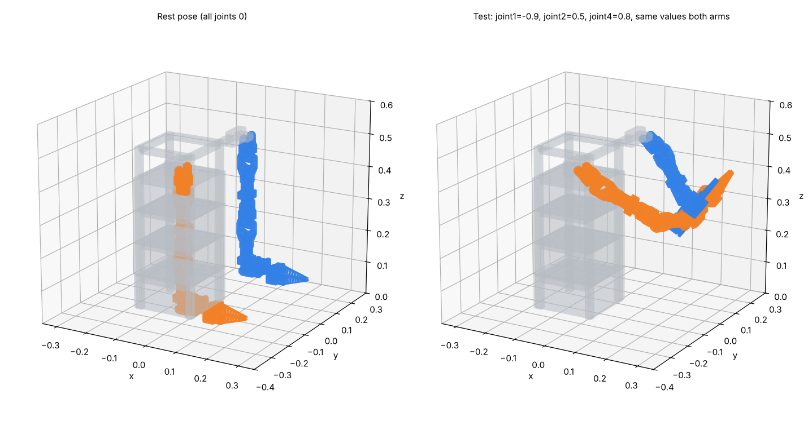

# v2: Body + Arm (ROS 2 Jazzy description package)

Dual-arm robot exported from the Fusion design **Body + Arm v8**: one body plus two 7-joint arms (6 arm joints and 1 gripper finger each). Same layout and launch files as the v1 package in the repo root, under a new package name so both can build in one workspace.



## Build and run
```bash
mkdir -p ~/arm_body_ws/src && cd ~/arm_body_ws/src
git clone https://github.com/Aqid2108/arm-body-ros2.git
cd ~/arm_body_ws
rosdep install --from-paths src -y --ignore-src
colcon build --symlink-install
source install/setup.bash

ros2 launch arm_body_v2_description display.launch.py                      # RViz + joint sliders
ros2 launch arm_body_v2_description gazebo.launch.py                       # Gazebo Harmonic + ros2_control
ros2 launch arm_body_v2_description gazebo.launch.py rviz:=true
ros2 launch arm_body_v2_description gazebo.launch.py self_collide:=true    # arms collide with body/each other
```
Installation of ROS 2 Jazzy, Gazebo Harmonic and ros2_control is the same as v1: see [docs/RUN_GUIDE.md](../docs/RUN_GUIDE.md), section 1.

## Move the arms (Gazebo running)
```bash
ros2 topic pub --once /left_arm_controller/joint_trajectory trajectory_msgs/msg/JointTrajectory \
"{joint_names: [l_joint1, l_joint2, l_joint3, l_joint4, l_joint5, l_joint6],
  points: [{positions: [-0.9, 0.5, 0.0, 0.8, 0.0, 0.0], time_from_start: {sec: 3}}]}"

ros2 topic pub --once /right_arm_controller/joint_trajectory trajectory_msgs/msg/JointTrajectory \
"{joint_names: [r_joint1, r_joint2, r_joint3, r_joint4, r_joint5, r_joint6],
  points: [{positions: [-0.9, 0.5, 0.0, 0.8, 0.0, 0.0], time_from_start: {sec: 3}}]}"

ros2 topic pub --once /left_gripper_controller/joint_trajectory trajectory_msgs/msg/JointTrajectory \
"{joint_names: [l_joint7], points: [{positions: [0.5], time_from_start: {sec: 1}}]}"
```
**The right arm mirrors the left:** send the same numbers to both arms for a mirror-image pose (the right arm's X-axis joints, `r_joint2/4/6`, have their axes flipped to make this work). Send all zeros to return to the rest pose.

## Robot
| Item | Value |
|---|---|
| Links | 16 (`world`, `body`, `l_link1`–`l_link6`, `l_finger`, `r_link1`–`r_link6`, `r_finger`) |
| Moving joints | 14 revolute: `l_joint1`–`l_joint7`, `r_joint1`–`r_joint7` |
| Fixed joints | 1 (`world_to_body`, puts the base of the body at z = 0) |
| Total mass | 3.23 kg (body 1.97 kg, each arm 0.63 kg) |
| Rest pose | all joints 0 = the pose in the Fusion file (arms hanging) |
| Controllers | `joint_state_broadcaster`, `left_arm_controller`, `right_arm_controller`, `left_gripper_controller`, `right_gripper_controller` |

| Joint | Parent → child | Axis (left / right) |
|---|---|---|
| joint1 | body → link1 | Y / Y |
| joint2 | link1 → link2 | +X / −X |
| joint3 | link2 → link3 | Y / Y |
| joint4 | link3 → link4 | +X / −X |
| joint5 | link4 → link5 | Y / Y |
| joint6 | link5 → link6 | +X / −X |
| joint7 (finger) | link6 → finger | Y / Y |

Each link is the bracket driven by the servo above it plus the servo bolted to that bracket; joint axes sit on the servo output shafts (centre of the 20 mm horn) taken from the CAD.

## Where the numbers come from
- **Geometry, joint positions and axes:** straight from Fusion (links verified to reproduce the CAD within 0.002 mm at rest).
- **Masses:** the Fusion file still has default steel on printed and aluminium parts, so masses are computed from each body's volume instead: printed parts PETG at 15% infill (0.33 × 1.27 g/cm³), 2020 extrusions aluminium 6061 (2.70 g/cm³), servos 74.5 g each (STS3250, as set in the CAD). Inertias are Fusion's, rescaled to these materials and taken about each link's centre of mass.
- **Effort / velocity:** 4.9 N·m and 7.85 rad/s on every joint (STS3250, 12 V), damping 0.1, friction 0.05.
- **Collision meshes** (`meshes/collision/`): simplified arm meshes (within 0.6 mm of the real shape) and one convex hull per body part.

## Before relying on it
- **Joint limits are placeholders.** The Fusion joints have no limits, so every joint is set to ±π (full servo travel around the rest pose). Edit the `*_lower` / `*_upper` properties at the top of `urdf/arm_body_v2_core.xacro`, then regenerate the plain URDF: `xacro arm_body_v2_core.xacro > arm_body_v2.urdf`.
- **Servo model:** every servo in this CAD is the STS3250 model. If some joints actually use STS3215, change their effort to 2.94 N·m, velocity to 4.7 rad/s and their mass to 55 g.

## Files
| Path | What |
|---|---|
| `arm_body_v2_description/urdf/arm_body_v2.urdf` | Plain URDF (no ros2_control) |
| `arm_body_v2_description/urdf/arm_body_v2_core.xacro` | Links, joints, limits; included by the main xacro |
| `arm_body_v2_description/urdf/arm_body_v2.urdf.xacro` | Main file: core + ros2_control + Gazebo plugin |
| `arm_body_v2_description/config/controllers.yaml` | joint_state_broadcaster + 4 JointTrajectoryControllers |
| `arm_body_v2_description/launch/` | `display.launch.py` (RViz), `gazebo.launch.py` (Gazebo) |
| `arm_body_v2_description/meshes/` | One STL per link (mm, scaled 0.001), plus `collision/` |
